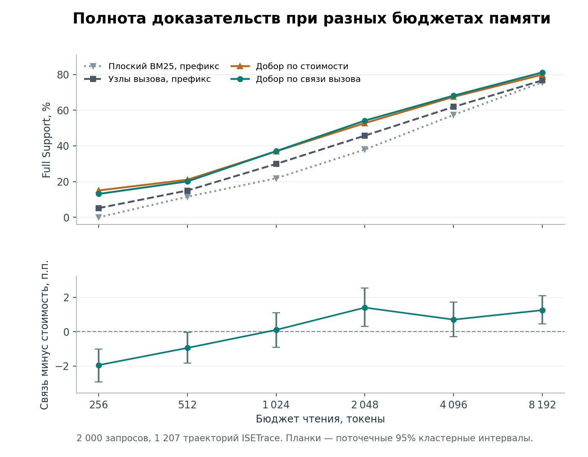

# Что меняется при другом лимите контекста

На тех же 2 000 запросах проверили шесть официальных бюджетов ISETrace. Преимущество связи «аргумент — результат» над добором по стоимости зависит от бюджета. При 256 и 512 токенах добор по стоимости выигрывал. При 2 048 токенах преимущество связи достигло +1,40 п.п. По всей кривой Full Support разность нормированных площадей составила лишь **+0,18 п.п.** (95% кластерный интервал от −0,42 до +0,79). Для площади Coverage разность −0,055 п.п. (от −0,60 до +0,49). [Все исходы](outcomes.json.gz) · [Средние и интервалы](summary.json)

| Способ чтения, Full Support (%) | 256 | 512 | 1 024 | 2 048 | 4 096 | 8 192 | Budget-AUC (%) |
|---|---:|---:|---:|---:|---:|---:|---:|
| Плоские блоки, штатный префикс | 0,00 | 11,50 | 21,85 | 37,95 | 57,35 | 75,65 | 33,30 |
| Узлы вызова, штатный префикс | 5,15 | 15,00 | 29,90 | 45,75 | 61,85 | 76,70 | 38,69 |
| Узлы, пропуск слишком длинного фрагмента | 12,70 | 19,95 | 35,55 | 51,00 | 65,95 | 79,25 | 43,69 |
| Узлы, добор по стоимости | 15,05 | 21,05 | 36,95 | 52,75 | 67,45 | 79,90 | 45,14 |
| Узлы, приоритет другой стороны того же вызова | 13,10 | 20,10 | 37,05 | 54,15 | 68,15 | 81,15 | 45,32 |

Данные взяты из полных запечатанных BM25-ранжирований. Подтверждено побайтное соответствие исходных архивов, поштучное совпадение всех назначенных адресов и равенство метрик всех 10 000 условий при 2 048 токенах с предыдущим измерением. При иных значениях бюджета использован тот же нативный оценщик. Авторы считают нормированную площадь методом трапеций по логарифму бюджета. Поскольку правило резервирует неизменённый BM25-префикс и использует только связи с уже взятыми узлами, при слишком длинном первом узле оно не получает исходного указания на связанную сторону. Это возможное объяснение зависимости от бюджета, а не доказательство механизма. [Реализация авторского Budget-AUC](https://github.com/xiaoqi-7/GraphMemory/blob/df29287116fa1565b3fd6b485022cd6090dc0b27/graph_memory/evaluation/span_suite.py) · [Протокол](PROTOCOL_RU.md)

Для повторения из этой папки в среде исходного ISETrace запустите `python -B sweep.py predict`, затем `python -B sweep.py score`. Команда `lock` предназначена для новой чистой копии протокола. Исходные восемь архивов ранжирований и связи для событий берутся из соседнего isetrace_official. Обе политики платят в нативных токенах кандидатов, включая повторные токены перекрывающихся блоков.

Планки для отдельных бюджетов получены парным ресемплированием траекторий, без одновременной поправки на шесть сравнений. Для построения графика по сохранённым поштучным исходам запустите python -B figure.py в среде с NumPy и Matplotlib. [Числа на графике](budget-intervals.json)
