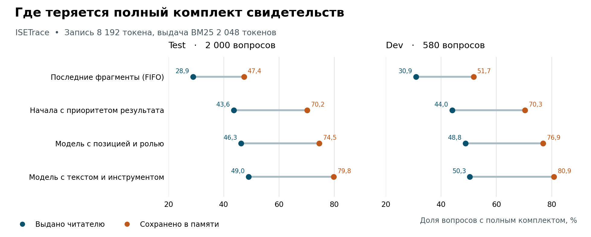

# Графовая память агента при ограничениях на запись и чтение

Самый устойчивый результат серии — **агенту выгодно учиться, какие части завершившегося наблюдения сохранить ещё до появления следующего вопроса**. Lia и Mazumder ранее предложили обучаемое вытеснение LRE. Здесь его принцип проверен на блоках инструментальных наблюдений при раздельных бюджетах записи и чтения. Весь файл параметров двух логистических моделей со служебными полями занимает 3 911 байт. На ISETrace она улучшила результат одного и того же поиска BM25 на **5,30 п.п.** против эвристики, отдающей приоритет началу результата инструмента. Прирост повторился на 580 других вопросах без изменения весов, **+6,38 п.п.** Прежняя гипотеза о преимуществе пар «вызов — результат» при чтении прошла более строгую проверку на обученном E5 и там преимущества не показала. На внешнем диалоговом корпусе отдельное расширение оригинального LRE улучшило опубликованную метрику macro-AUC с **0,829 до 0,844**. [Запись на ISETrace](write_learned/REPORT_RU.md) · [Обученный ранжировщик](trained_rank/REPORT_RU.md) · [Прямое сравнение с LRE](locomo_edges/REPORT_RU.md)

## Что хранит агент

Вершина — уже завершённый вызов инструмента или его ответ. У фрагмента есть адрес в событии, роль и стоимость. Сразу после получения события его делят на блоки примерно по 64 WordPiece. Для каждого блока доступны его положение внутри события, тип инструмента и простые признаки текста, например наличие пути, числа или сообщения об ошибке. Логистическая модель присваивает блоку балл на основе того, как часто похожие блоки в обучении пересекались с будущими размеченными свидетельствами. Калибровку вероятностей отдельно не проверяли. При переполнении памяти блок с низким приоритетом удаляется. Для применения модели не требуется полный индекс репозитория или запрос к генеративной модели. Политика обучена по пересечению блока с эталонными координатами на 256 отдельных train-траекториях, в которых 411 вопросов и 145 498 блоков, из них 844 положительных. Это разреженная разметка: неразмеченный блок может содержать полезную информацию для других возможных вопросов. [Признаки и способ обучения](write_learned/REPORT_RU.md) · [Сохранённые параметры](write_learned/model.json)

Зафиксированы два бюджета: до 8 192 токенов на траекторию в памяти, до 2 048 в выдаче на конкретный вопрос. **Полный комплект** означает, что сохранён или выдан каждый символ всех эталонных фрагментов вопроса. На тесте 2 000 вопросов из 1 207 траекторий, на отдельном dev — 580 из 352. Эти наборы не пересекаются по траекториям и вопросам. На знакомом публичном тесте уже исследовались иные политики, поэтому в отчётах различаются заранее зафиксированные контрасты и разборы после просмотра исходов. Разметка ISETrace относится к синтетическим OS-agent траекториям с реальными результатами исполнения; перенос в разработку проверяется отдельными задачами. [Разбиение](write_transfer/split-audit.json) · [Ограничения исходной работы](https://arxiv.org/html/2609.25913v3)

| Политика записи | Test, сохранено | Test, извлечено BM25 | Dev, сохранено | Dev, извлечено BM25 |
|---|---:|---:|---:|---:|
| Последние фрагменты (FIFO) | 947 | 577 | 300 | 179 |
| Начала с приоритетом результата инструмента | 1 403 | 873 | 408 | 255 |
| Обучаемое правило с позицией и ролью | 1 490 | 926 | 446 | 283 |
| Обучаемое правило с признаками текста и инструмента | **1 595** | **979** | **469** | **292** |

При тех же весах и байтовом лимите проверили жёсткий вариант учёта расходов, когда из 32 768 байт для каждой траектории сразу вычитаются все 3 911 байт файла параметров. Остаётся 28 857 байт на UTF-8, адреса и заголовки. Полная выдача — **969/2 000 против 855/2 000** у эвристики с полным бюджетом; на dev **293/580 против 253/580**. Поштучные интервалы в исследованиях ISETrace рассчитываются парным bootstrap целых траекторий, 10 000 повторов. Повторные вопросы одной траектории не считаются независимыми репликами обучения. [Результаты и проверка цены](write_learned/transfer-results.json)

Разные ID траекторий не исключают дословного повторения содержимого инструментов. В ретроспективной проверке исключили вопросы, у которых хотя бы одно целое исходное поле, содержащее эталон, уже встречалось в обучении писателя. Преимущество сохранилось: **943/1 922 против 843/1 922** на test, +5,20 п.п. [3,73; 6,69]; на dev **282/556 против 248/556**, +6,12 [2,76; 9,56]. Это защита конкретно от повторов целого поля. [Аудит содержания и независимости разбиений](split_overlap/REPORT_RU.md)

### Почему запись помогает поиску

Сохранили ранги BM25 по всей истории, затем провели два последовательных вмешательства. Сначала маска обученной памяти убрала недоступные блоки, сохранив прежний порядок остальных. Затем пересчитали BM25 на фактически оставшихся текстах. На test получилось **831 → 976 → 979** полных комплектов. Из выигрыша в 7,40 п.п. относительно доступа ко всей истории ограничение кандидатов дало +7,25 п.п. [5,58; 8,95], изменение весов BM25 +0,15 [−0,30; 0,60]. На dev получено **258 → 296 → 292**. На test фильтрация улучшила также **среднее покрытие эталонных символов**, +4,27 п.п. при неизменных рангах. У простой эвристики начал могли расти полные комплекты и одновременно падать среднее покрытие. Этим двум механизмам соответствуют разные прогнозы о частично решённых вопросах. [Независимый пересчёт разложения](learned_mask/REPORT_RU.md) · [Эвристики и чувствительность](online_write/REPORT_RU.md)

Откуда взялись именно 106 дополнительных полных выдач относительно эвристики начал? В 264 вопросах только обученная политика сохранила весь эталон, и BM25 реализовал 135 из этих возможностей. В 72 вопросах только эвристика сохранила эталон, и обученная политика потеряла 32 выдачи. На 1 331 вопросе, где обе сохранили всё нужное, чистый выигрыш составил лишь три. Получается **135 − 32 + 3 = 106**. На dev то же ретроспективное разложение даёт **46 − 15 + 6 = 37**. Группы определяются по исходу обеих детерминированных политик на одном вопросе. Эффекты внутри групп описательные. [Расчёт по исходам каждой пары](stage-effects.json)

Объяснимый базовый эффект даёт широта хранения: начало каждого события при 8 192 токенах сохранило полный эталон для **1 367/2 000**, FIFO — для **947/2 000**; в среднем представлено 58,9 и 21,2 события. Эта разница сохранилась и при равном размере сериализованного состояния. Попытка удерживать аргумент и его результат совместно единым приоритетом дала **67,60% против 67,95%** у контроля со смещёнными рёбрами. Сигнал о структуре на момент записи сам по себе не повышает полезность любой политики. [Контроли записи](online_write/REPORT_RU.md) · [Повтор на dev](write_transfer/REPORT_RU.md)

### Что меняется с нейронным читателем

Тот же обученный E5 строил векторы заново из точного текста оставшихся 64-токенных блоков. Полные исходные поля и ранее полученные векторы более длинных полей читателю недоступны. При одинаковых бюджетах плотный поиск после обученной записи выдал весь комплект для **1 315/2 000 (65,75%)**, после эвристики начал — **1 213/2 000 (60,65%)**, после FIFO — **751/2 000 (37,55%)**. Прибавка над эвристикой **+5,10 п.п.** [3,39; 6,80]. На dev тот же контраст **402/580 против 362/580**, +6,90 п.п. [3,68; 10,12]. Среднее символьное покрытие на test тоже выросло на 6,27 п.п. У весов E5 было 500 dev-вопросов на этапе выбора чекпойнта, поэтому подтверждающая панель для нейронного читателя — прежде всего test. Писатель на dev не подбирали.

Среди 1 331 вопроса, где обе памяти сохранили весь эталон, плотный читатель после обученной записи собрал на 26 комплектов меньше (1 132 против 1 158). На вопросах, для которых все свидетельства сохранила только одна политика, получено 183 дополнительных выдачи и потеряно 55. Итог **183 − 55 − 26 = 102** показывает, почему выигрыш нельзя объяснить только удобством ранжирования уцелевших фрагментов.

Хранение текста с адресами занимало в среднем 31 843 байта на тестовую траекторию обученной политики. Если постоянно хранить дополнительно FP32-вектор каждого уцелевшего блока, индекс потребует в среднем ещё **425 369 байт**, плюс глобальные веса. Лимит 8 192 относится к исходному тексту. Прямой учёт 32 КиБ для состояния и параметров выше относится к варианту с BM25 и описанному формату хранения. [Плотный читатель и физические затраты](bounded_dense/REPORT_RU.md)

## Сопоставление с опубликованными сильными методами

**Чтение полной истории ISETrace.** E5-base-v2 дообучен на локальной RTX 3090 с исходным нативным протоколом provenance-unit Dense-FT, одна эпоха, 3 894 train-вопроса, 500 dev-вопросов для выбора весов, seed 13. Стандартный префикс дал **72,90% Full Support@2048** против **72,78 ± 0,64%** в пяти запусках авторов. При тех же рангах пропуск слишком дорогих блоков и добор следующих дали **75,15%**, приоритет второго конца вызова — **74,70%**. Их парная разница **−0,45 п.п.** [−1,01; 0,10] при практически одинаковом расходе: около 2 039 токенов. На замороженном E5 в предыдущей серии разница составляла +2,00 п.п. Разность этих эффектов на одних и тех же запросах −2,45 п.п., 95% ДИ [−3,57; −1,40]. [Проверка взаимодействия](tail_read/INTERACTION_RU.md) Опубликованный лучший residual R-GCN имеет **77,33 ± 0,53%**, оставаясь выше результатов этих способов упаковки. Опубликовано стандартное отклонение по пяти seed обучения, наши интервалы — по тестовым траекториям одного seed. [Эксперимент](trained_rank/REPORT_RU.md) · [Таблица 1 оригинала](https://arxiv.org/html/2609.25913v3)

Попытка заполнить остаток бюджета 64-токенными отрезками дала на обученном E5 **74,60%** против **74,70%** при доборе целых связанных блоков. Для дополнительного варианта, объединяющего ранг родителя и локальный BM25 с помощью RRF, полнота всего комплекта **75,00%**, зато среднее покрытие выросло **с 80,14% до 80,77%**, разница +0,62 п.п. [0,18; 1,08]. Та же метрика выросла на замороженном E5. Если показать оценщику правильные ответы, теоретически достижимы **80,20% FS** при тех же допустимых блоках и префиксе. Эта верхняя граница показывает запас для улучшения ранжирования; её нельзя предъявлять как результат работающего агента. [Основной и дополнительные контрасты](tail_read/REPORT_RU.md)

**Диалоговая память LoCoMo.** Запустили LRE-supervised на авторском коде, со всеми десятью fold и их дедупликацией. Воспроизведено **0,82896 macro-AUC** при опубликованных **0,829**. Добавление данных о предыдущей реплике того же диалога дало **0,84432**, контроль со смещённым предшественником — 0,82920. Абляция локализует большую часть инкремента в признаках предыдущего вопроса собеседника и длины ответа. У заранее выбранной метрики Recall при сохранении 20% реплик выигрыш с 50,75% до 51,82%; при десяти диалогах точный двусторонний p = 0,09375. На 10% бюджета Recall снизился с 29,31% до 28,18%. Это прямое улучшение конкретного опубликованного AUC; генерация ответов и другие протоколы LoCoMo в сравнении не участвовали. [LoCoMo и исходы по диалогам](locomo_edges/REPORT_RU.md) · [LRE, таблица 3](https://arxiv.org/html/2606.20954v2)

## Перенос в решение агента

Локальный Qwen3.8-27B в квантизации UD-Q4_K_M получил один и тот же прямой вопрос и мог одним вызовом открыть одно событие из предложенных. Открытие возвращало только сохранившиеся и уже допущенные в меню части события. Сравнили все 36 вопросов старой панели на разных траекториях. Шесть пар меню совпали; всего выполнено 66 реальных вызовов модели и проверено 72 условия.

Полное свидетельство в открытом событии оказалось в **14/36** случаях после обученной записи и **12/36** после эвристики. Два вопроса выиграны, ни один не проигран по бинарной метрике; точный двусторонний тест Мак-Немара **p = 0,50**. Среднее покрытие: 47,13% и 41,40%, ДИ разницы [−3,88; 16,28] п.п. Даже идеальный выбор одного видимого события мог дать максимум 16/36 и 15/36. Прежний предметный фильтр содержимого отсёк по 180 отдельных блоков, и открытое событие имело разную стоимость — в среднем 276 против 205 токенов. Этот тест даёт ограниченное свидетельство переноса в выбор источника. Для вывода об успехе решения задач данных недостаточно. [Панель, контроль и реальные вызовы](writer_action/REPORT_RU.md)

## Реальные тесты на коде

- **Loguru.** На четырёх ранее не отбиравшихся изменениях память о прочитанных ресурсах сократила число назначенных тестовых файлов с **56 до 42**, сохранив **16/16** затронутых по авторской разметке. NameRTS потребовал **17 файлов** при той же полноте. Весь прирост против сброса пришёлся на одно изменение файла типов. В 35 контролируемых сценариях добавление наблюдений `stat` вернуло реально упущенную регрессию: **6/6** обнаружено при 21 проверке против **5/6** при 15. Ценность имеет вид обращения к ресурсу: тест может читать метаданные файла без чтения содержимого. [Полная панель и исходы](resource_memory/REPORT_RU.md)
- **Boltons.** Для 48 искусственных изменений сравнения чисел в реальных версиях библиотеки выбирали один из ранее прошедших тестов соответствующего модуля (122 теста суммарно, медиана — пять кандидатов). Точные наблюдения равенства, достижимость и лексический контроль обнаружили **10/48** каждый. На 46 собираемых изменениях исчерпывающая проверка нашла лишь десять, ещё в двух случаях выполнение прервалось при импорте. По сравнению с намеренно нарушенными связями эффект виден, но относительно простых контролей преимущество отсутствует. [Проверенные команды и потолок](action_transfer/REPORT_RU.md)

## Направление для статьи

Мотивированная гипотеза — **при ограниченной памяти полезнее оценивать ожидаемую ценность наблюдения на записи, а ценность связей проверять отдельно для конкретного читателя**. Наиболее убедительная часть — перенос лёгкого правила, парные сравнения при равной стоимости и воспроизводимое разложение эффекта маски. Прибавка над LRE на внешнем диалоговом AUC относится к отдельному расширению и служит дополнительным примером того, что информативность типа связи зависит от задачи. Для статьи о кодовом агенте решающей внешней проверкой будет успех следующего действия на ранее не использованных естественных задачах программирования, с фиксированным решателем и той же ценой контекста. Результаты естественных изменений и искусственных мутаций выше задают реальные контрольные методы и показывают, где насыщение тестов ограничивает способность различить политики.

[Первичные публикации и границы сопоставимости](RELATED_WORK_RU.md) · [Все исследования и воспроизведение](REPRODUCE_RU.md)
