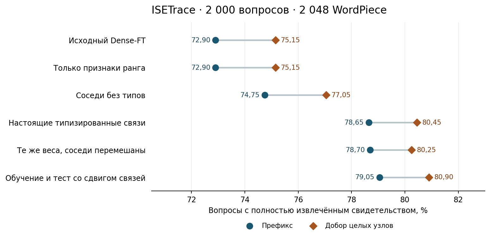

# Какие свойства графа помогают агенту сохранить и извлечь свидетельство

На ISETrace проверяем, может ли агент извлечь все исходные фрагменты, нужные для ответа, в пределах 2 048 токенов. В графе истории узлы — интервалы из аргументов и результатов инструментов. Тип и направление ребра показывают, например, что фрагменты соседние в одном результате или что выход относится к определённому вызову. Полный тест содержит 2 000 вопросов из 1 207 отложенных траекторий. Для сравнения методов записи архив дополнительно ограничен 8 192 токенами ещё до появления вопроса. Бенчмарк основан на синтетических, привязанных к исполняемой среде историях OS-агентов. [Исходная работа Wang et al.](https://arxiv.org/html/2609.25913v3) · [Источники и соседние работы](RELATED_WORK_RU.md)

## Что в графе действительно дало прирост

**Разные узлы одного и того же семантического ранга имеют разную вероятность содержать эталон.** На исходном Dense-FT зафиксировали кандидатов, порядок исходного ранга, лимит и авторское правило чтения префикса. Целиком свидетельство нашлось для 1 458/2 000 вопросов (72,90%). Если обучить лёгкий читатель на 500 dev-вопросах и добавить ранг соседей с типом и направлением ребра, результат составил 1 573/2 000 (78,65%), разность +5,75 п.п. [4,15; 7,35]. При переподключении рёбер с сохранением числа входов и выходов каждого типа модель дала 79,05%. Сами типизированные степени узла и его исходный ранг дали 79,05%, роль плюс степени и ранг — 79,55%. Одна роль дала 72,90%, а роль и степени без численного семантического ранга — 56,00%. На этом сравнении эффект сохраняется, когда конкретные соседи меняются. [Исходы, контроли и стоимость](typed_reader/REPORT_RU.md)

Для проверки без дополнительной dev-разметки обучили структурные признаки на лексических рангах 3 894 вопросов исходного train и применили веса к тестовым рангам Dense-FT. При настоящих типизированных связях получили 75,85%, при признаках роли и степеней — 75,70%, против тех же 72,90%. Следовательно, часть сигнала сохраняется при смене ранжировщика. В дополнительном разборе вариант, обученный на лексическом train, дал +9,50 п.п. по Full Support на 516 вопросах, где эталон расположен в нескольких событиях, и +0,47 п.п. на 1 484 вопросах с одним событием. Страты определены ретроспективно по аннотации. Расчёт собственных степеней не требует при каждом вопросе заново прогонять нейронные сообщения по графу. Результат относится к уже построенному графу истории, его построение и доступ к наблюдениям входят в стоимость системы. [Полное исследование признаков](typed_reader/REPORT_RU.md)

## Раздельное обучение структурной и семантической частей

На большей части исходного train оцениваем априорную пригодность узла до вопроса. Для калибровки семантического ранга используем отдельную маленькую часть train с плотными векторами. Основной отбор этой части сделан по хешу. Дополнительный, по доступным векторам, даёт 77,70% для полной суммы двух логитов и 78,25% для версии с восемью степенями при 72,90% у Dense-FT. Полный состав графа, лучшую подвыборку и параметры по тесту не подбирали. У сложения логитов есть вероятностная интерпретация при условной независимости сигналов; её выполнение на реальных данных не установлено. [Формула, разбиения и поштучные результаты](factor_reader/REPORT_RU.md)

## Изменение масштаба чтения

Читатель обучается оценивать 64-токенные части уже ранжированного родителя размером до 504 токенов. На полном Dense-FT первичная версия, обученная на dev, с двумя защищёнными родителями и скором p/стоимость дала **76,00% против 75,15%** у добора целых узлов. 95% ДИ разности [−0,60; 2,30] п.п. Покрытие эталона выросло с 80,83% до 84,85%, +4,03 п.п. [2,95; 5,13]. Скор p без деления дал 76,95%, вариант без защищённых родителей — 77,45%; это вторичные сравнения. На 128 траекториях дополнительное ранжирование при подготовленном индексе заняло медианные 1,31 мс CPU на вопрос против 0,004 мс у простого добора. [Проверенные размеры и вычислительная стоимость](fine_read/REPORT_RU.md)

У читателя, обученного на лексических рангах полного train и применённого к Dense-FT, первичная гипотеза провалилась. Вариант p/стоимость дал 72,65% против 75,15%, хотя покрытие выросло до 82,48%. Если в задаче важно получить **все** части доказательства, выигрыш по среднему покрытию может сопровождаться потерей полностью обеспеченных ответов. Отдельно проверили, сколько места освобождает объединение перекрывающихся цитат с сохранением исходных координат. На Dense-FT оно дало 1 513/2 000 против 1 503/2 000 при фактически проверенном лимите 2 048, 10 выигрышей и 0 потерь. Объединение интервалов известно по предшествующим системам. Здесь измерен его вклад в точных условиях сравнения. [Обучение на лексическом train](fine_lextrain/REPORT_RU.md) · [Объединение цитат](union_read/REPORT_RU.md) · [Малые обучающие выборки](fine_subset/REPORT_RU.md)

## Запись по ходу работы

Для онлайн-отборщика изменили функцию потерь, чтобы при обучении учитывалась самая уязвимая часть комплекта свидетельств. У исходной политики весь эталон остался в архиве в 1 595/2 000 случаев. У нового варианта — в 1 615/2 000, разность +1,00 п.п. [0,10; 1,94]. На 580 других вопросах получено 469 → 483. После поиска BM25 первичная разность меньше: на основном тесте 979 → 991, +0,60 п.п. [−0,20; 1,40]. Попытка повысить приоритет старого вывода, если его литерал повторился в следующем вызове, дала 974 против 979. Срабатывания в 1 204 траекториях оказались частыми, а полезных замен недостаточно. [Функция потерь по комплекту](set_writer/REPORT_RU.md) · [Повышение приоритета](online_update/REPORT_RU.md)

Перенос тех же весов графовых степеней на необратимое вытеснение ухудшил результат. После чтения из архива полный эталон на тесте сохранился в 954 из 2 000 случаев против 979 у исходной записи (−1,25 п.п., 95% ДИ [−2,28; −0,25]). На другой панели получили 277/580 против 292/580. Во время записи доступны только уже наблюдавшиеся связи, а цена ошибки включает потерю возможности перечитать вытесненный фрагмент. [Потоковое обновление степеней](degree_write/REPORT_RU.md)

На LongMemEval-S при записи *только по уже поступившим репликам*, с необратимым вытеснением и лимитом 4 096 WordPiece, добавление роли и ранга длины среди прошлых реплик этой роли повысило macro Recall с 49,60% до 60,34%, разность +10,73 п.п. [3,95; 18,64]. Из 62 выбранных историй 59 имеют разметку; источники разных историй этой панели не пересекаются. На 420 других размеченных историях получилось 48,24% → 55,63%. Для зависимых дополнительных историй эта оценка описательная. В режиме с доступом к полной истории и бюджетом 20% реплик результат 59,27% → 67,74%. При переносе старой модели с LoCoMo без обучения на LongMemEval её результат был ниже 4%. [Потоковое хранение и разложение по признакам](dialogue_stream/REPORT_RU.md) · [Вся история](dialogue_calibration/REPORT_RU.md) · [Межкорпусный перенос](dialogue_transfer/REPORT_RU.md)

## Передалась ли память в действие агента

На QuixBugs исходный learned writer R19 дал правильный следующий шаг в 22 из 36 контролируемых эпизодов, FIFO — в 25, полная история с BM25 — в 33. Специализированная запись наблюдавшегося идентификатора упавшего теста дала 35/36 при состоянии до 106 байт. Оценка использует реальные повторные вызовы pytest. На естественных журналах VibeMemBench нашлись только четыре независимых подходящих повторения одной команды; все повторные запуски были успешными. На отдельном публичном наборе задач с кодом Qwen3-4B-Instruct-2507 при выборе одной из двух реализаций дал 7/8 с правильной памятью прежнего сеанса и 5/8 без неё. Проверены четыре задачи в двух порядках кандидатов, исход считается авторским исполняемым checker. Это маленькая проверка использования конкретного наблюдения. [QuixBugs](code_transfer/REPORT_RU.md) · [Естественные журналы](code_archive/REPORT_RU.md) · [Проверка контролируемого выбора реализации](published_outputs/REPORT_RU.md)

## Отношение к опубликованному результату

У основной строки авторского R-GCN Full Support@2048 составляет **77,33 ± 0,53%**, Coverage@2048 — **81,88 ± 0,49%** (среднее ± SD по пяти независимым инициализациям). В §7.2 удаление связности соседних чанков улучшило основной результат на 1,26 п.п. Из двух округлённых чисел получается ориентир около 78,59%. У нашего семантического Dense-FT результат одного seed. Значения 78–80% у части новых вариантов численно выше опубликованного среднего. Для утверждения о новом SOTA требуется прямое сравнение в одинаковых условиях, с согласованной статистикой по seed и с независимой проверкой после разработки. В частности, dev-supervised варианты используют 500 дополнительных размеченных примеров. Поштучные ранги пяти авторских seed и 469 QA-записей не найдены среди проверенных публичных материалов. Для исходной плоской BM25-строки воспроизведены обе опубликованные метрики на всех 2 000 вопросах. [Опубликованное сравнение](https://arxiv.org/html/2609.25913v3) · [Аудит выпущенных артефактов](published_outputs/REPORT_RU.md)

Для статьи самый проверяемый вопрос сейчас — какая доля пользы графовой памяти объясняется структурным приоритетом узлов и сколько добавляет распространение информации по их **конкретным соседям**. Для этого нужны одинаковый семантический encoder, одинаковые кандидаты, отдельные degree-only и topology controls, учёт стоимости обновления графа и проверка переноса на действие кодового агента. Полный расчёт и контрольные CPU-конфигурации задокументированы отдельно. [Нативный R-GCN](residual_graph/PROTOCOL_RU.md) · [Выбор момента вызова графа](graph_trigger/REPORT_RU.md) · [Вычислительное состояние](RESEARCH_STATUS_RU.md) · [Воспроизведение](REPRODUCE_RU.md)

В заранее определённой калибровочной части hash64 использован 101 вопрос из 64 обучающих траекторий. На исходном тесте семантический и структурный компоненты вместе дали **1 566/2 000 (78,30%)** против 1 458/2 000 у Dense-FT, +5,40 п.п. [3,80; 6,93]. Вариант со степенями дал 1 575/2 000 (78,75%), +5,85 п.п. [4,32; 7,34]. Упрощённая модель, обученная на тех же данных только со связями между действиями, дала 1 523/2 000, а модель со степенями внутри вызова и его фрагментов — 1 487/2 000. Полная модель использует обе группы. Эффект проверен на одном семантическом энкодере. [Калибровка hash64](factor_reader/REPORT_RU.md) · [Декомпозиция по каналам связей](factor_reader/channel_controls/REPORT_RU.md)

На дополнительных 80 вопросах, исключённых из официальной dev500-калибровки, train-only factor и degree-only сохранили весь эталон в 58/80 случаев против 52/80 у Dense (для factor +7,50 п.п. [−1,27; 16,67]). Для 27 вопросов из полностью новых историй роль и степени с обучением на лексических рангах дали 17/27 против 13/27, с широким ДИ. При полном исходном train из 3 894 вопросов оценка полезности 64-токенных фрагментов также стала успешнее: по Dense primary p/c дал 1 543/2 000 против 1 503/2 000 у skip, +2,00 п.п. [0,69; 3,37]. Это сравнение касается двух вариантов упаковки и одного encoder seed. [Дополнительная панель](untuned_holdout/REPORT_RU.md) · [Читатель на полном train](fine_train/REPORT_RU.md)
