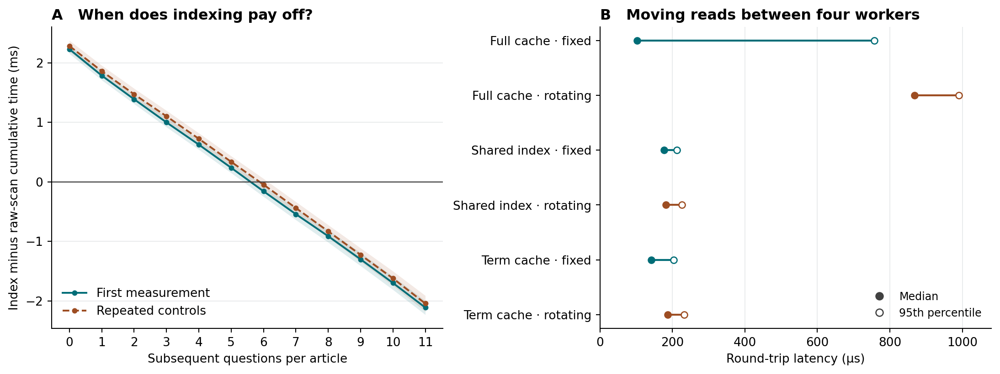

# Индекс эпизода, длительность работы читателя и цена записи

Измерили, когда стоит строить поисковый индекс по уже прочитанным агентом окнам. Слой БД узнаёт об этих окнах из реально показанного контекста, записывает сырой текст один раз и обеспечивает одинаковый точный BM25-поиск при смене вопроса. Полный цикл включает публикацию эпизода в SQLite, COMMIT и все последующие запросы. Проверено 624 разных запроса, в основной и дополнительной панели суммарно 22 464 индивидуальных исхода с учётом вариантов и повторов.

При **одном вопросе** к истории кодового агента медиана полного цикла минимального журнала составила 1,21 мс, а у инвертированного индекса — 2,12 мс. Для **одиннадцати вопросов** к статье SQuAD получилось 6,30 против 4,11 мс. Внутри тех же 48 статей точки окупаемости различались, медиана — шесть запросов в обеих панелях. При возможности сохранять разобранный эпизод в памяти одного исполнителя все 11 ответов были получены за 2,06 мс, при сбросе этого кэша через каждые три вопроса — за 4,48 мс. Цена резидентного варианта на статью — медианные 198 КБ объектов Python. Это наблюдение уточняет вывод предыдущей серии о преимуществе готового индекса на чтении. [Протокол, лог каждого решения и результаты](write_cost/REPORT_RU.md)

Для демонстрации памяти можно воспроизвести один и тот же эпизод, изменить число и порядок обращений, выбрать жизненный цикл читателя и наблюдать точный адрес, объём повторно прочитанного текста и затраты на запись. Эти измерения относятся к локальной SQLite и неизменному источнику в границах эпизода. Системная гипотеза касается того, какие вспомогательные структуры БД экономически оправданы после реального чтения агентом. [Контроль с минимальной записью](write_cost/PROMOTION_RU.md) · [Требования ICDE к демонстрационным сценариям](https://icde2027.github.io/cf-demonstrations.html)

Проверка сохранённых данных `python -B verify.py` в директории серии. Перечень завершённых экспериментов и отдельно открытых исследований содержится в `release.json`.

## Передача состояния исполнителю

Четыре изолированных процесса с отдельными кэшами и соединениями SQLite получили один поток из 528 вопросов. У всех процессов ровно по 132 запроса при обоих способах маршрутизации. С четырьмя местами под эпизоды на каждого исполнителя закрепление статьи дало 48 полных чтений сырых окон на всю нагрузку, ротация между процессами — 528. У общего индекса по словам в обоих режимах в среднем возвращалось 366 байтов на запрос. Гибрид «общий индекс + кэш запрошенных слов» при закреплении снизил эту величину до 87 байтов. У полного локального кэша при закреплении медиана RPC была ниже общей БД, но p95 — выше из-за необходимости загрузить статью целиком при первом обращении. Все методы выбрали те же адреса. Для измеренного расписания смену режима полностью объясняет число различных эпизодов с предыдущего обращения каждого исполнителя. [Архитектура, проверка поштучно и 14 конфигураций](worker_cache/REPORT_RU.md)

## Перенос направления чтения на исходники

На SWE-Explore сопоставили действительно записанные пары чтений в одном уже открытом Python-файле. Для 17 естественных переходов по 16 задачам двусторонняя выдача покрыла в среднем 69,19% строк следующего запроса против 65,42% у продолжения вправо, разность +3,78 п.п., 95% ДИ [−7,20; +13,69]. Строгая фильтрация здесь необходима: из команд с неограниченным концом чтения нельзя восстановить, какой текст реально увидел исполнитель. На 102 задачах Loc-Bench другой целевой переменной служили исходные строки человеческого изменения в известном файле. Получилось 17,54% против 19,23%, разность −1,69 п.п. [−5,54; +1,69]. Сильный контроль повторным лексическим поиском дал около 19,6%. Положительный эффект на вопросах к документам пока не обосновывает перенос на работу с кодом. [Две постановки и независимый аудит](code_boundary/REPORT_RU.md)

## Наиболее близкий опубликованный способ чтения

Использовали оригинальный SentenceWindowNodeParser LlamaIndex и построили 94 831 узел из 442 статей SQuAD. На тех же 5 304 вопросах при одинаковой индивидуальной стоимости видимых токенов чтение двух краёв дало 5 125 полных диапазонов против 5 099 у одного окна «предложение и три соседа с каждой стороны», разность +0,49 п.п. Более сильный контроль берёт по три соседних предложения у **обеих** границ и вычитает ранее показанные символы. При одинаковых фактических 155,25 WordPiece он дал **5 120 против 5 121** у токенных краёв. Разность +0,019 п.п., 95% кластерный ДИ [−0,057; +0,094], три выигрыша и два поражения. При общем максимуме 256 адресный контроль затратил в среднем 156,29 токена против 246,94. Это ограничивает утверждение о новизне: польза открытия двух окрестностей воспроизвелась, превосходство конкретного токенного правила над сильным предложенческим способом не установлено. [Полный эксперимент](sentence_window/REPORT_RU.md)

Слева — парная средняя разность на 48 статьях с поточечными 95% интервалами по статьям в двух технических панелях. Справа — медиана и p95 времени RPC при ёмкости четыре эпизода на исполнителя. Оба эксперимента перепроверены независимо по входным UTF-8 данным, журналам решений, байтам и расписанию. [Аудит](system_audit/REPORT_RU.md) · [Код графика](figure.py)
