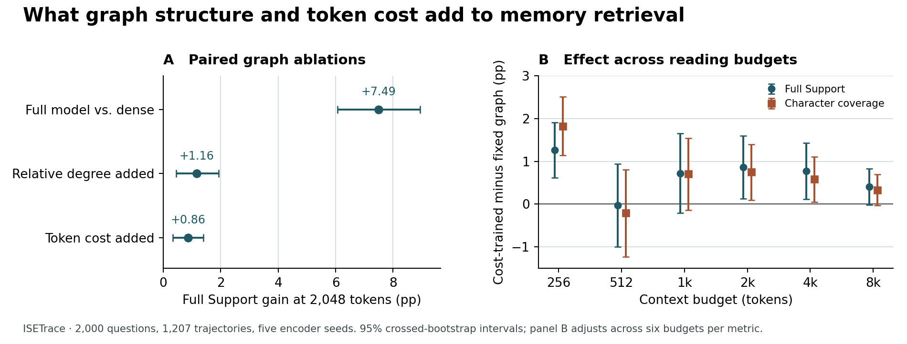

# Насколько эффект зависит от инициализации и выборки траекторий

У бюджетного ранжировщика пять обученных реализаций Dense-FT отвечают на одни и те же 2 000 вопросов из 1 207 траекторий. Двухфакторная перевыборка позволила оценить чувствительность главного эффекта к обоим источникам вариативности. При исключении любого одного seed выигрыш калибровки по стоимости относительно графа без неё составляет от +0,80 до +0,89 п.п. Full Support при 2 048 токенах. В двухфакторном bootstrap разность **+0,86 п.п. [0,33; 1,40]**. При одновременной поправке на шесть исследованных бюджетов интервал на этой точке равен **[0,13; 1,59]**. [Числа](results.json) · [График в PDF](budget-effects.pdf)

| Изменение | Эффект, п.п. | 95% интервал, траектории и seed |
|---|---:|---:|
| Полная бюджетная модель против Dense-FT, FS@2048 | +7,49 | [6,06; 8,94] |
| Добавление ролевых процентилей к абсолютным степеням, FS@2048 | +1,16 | [0,44; 1,92] |
| Калибровка с ценой чтения поверх ролевых процентилей, FS@2048 | +0,86 | [0,33; 1,40] |
| Оба изменения к прежнему структурному приоритету, FS@2048 | +2,02 | [1,16; 2,89] |
| Калибровка с ценой чтения, Coverage Budget-AUC | +0,58 | [0,31; 0,84] |
| Калибровка с ценой чтения, Full Support Budget-AUC | +0,63 | [0,34; 0,92] |

По одновременным интервалам выигрыш калибровки Full Support наблюдается при 256, 2 048 и 4 096 токенах. При 512 токенах и для остальных бюджетов интервал захватывает ноль. Интервалы скорректированы по шести бюджетам отдельно внутри каждой метрики. Отбор методов во всей исследовательской программе и повторное использование теста этим не корректируются. Пять seed дают мало информации о распределении результатов будущих моделей. Симуляция использует 20 000 перевыборок, которым соответствуют наблюдаемые, а не вновь обученные модели. [Протокол](PROTOCOL_RU.md) · [Исходные агрегаты по траекториям и seed](clusters.json.gz)

